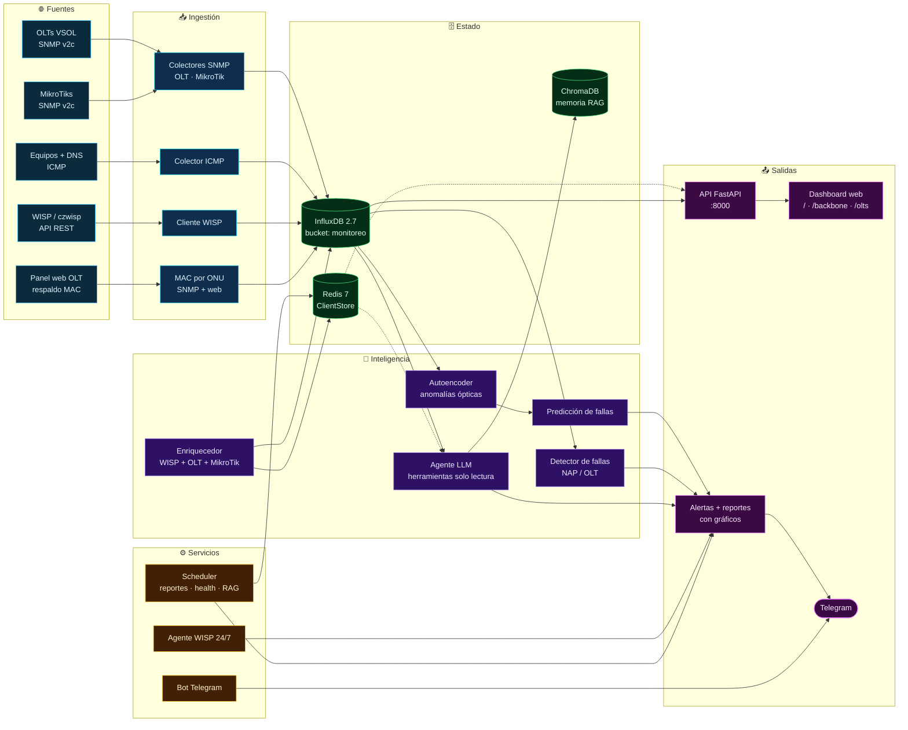

<div align="center">
<picture>
  <source media="(prefers-color-scheme: dark)" srcset="assets/hero-dark.svg">
  
</picture>

<!-- ======================= BADGES : STACK ======================= -->
| | |
|:---|---:|
|  |  |
|  |  |
|  |  |
|  |  |
|  |  |
|  |  |
|  |  |
|  |  |

</div>

---

Sistema de **monitoreo autónomo** para proveedores de Internet **FTTH/GPON**. Recopila datos de OLTs y MikroTiks vía **SNMP**, mide disponibilidad con **ICMP**, detecta **anomalías ópticas** con un **autoencoder** (PyTorch), correlaciona fallas con los **clientes afectados**, y genera **análisis y alertas automáticas** con un **agente LLM** (Ollama / OpenRouter / Anthropic). Todo se presenta en un **dashboard web** (FastAPI + InfluxDB + Redis) y se notifica por **Telegram**, con **reportes diarios illustrated** con gráficos.

> **🔒 Nota de seguridad:** los secretos (tokens, passwords, communities SNMP, topología real, datos de clientes) **no** se incluyen en el repositorio: se cargan desde `.env` / `.env.ia` y de archivos ignorados por `.gitignore`. Ver [Seguridad](#-seguridad).

---

## ✨ Características

| 🛰️ Colectores SNMP | 🧠 Anomalías con IA | 📡 Monitoreo ICMP |
|:---:|:---:|:---:|
| Potencia óptica ONU (RX/TX dBm), puertos GE/PON, CPU/RAM/temp de OLTs y MikroTiks, tráfico de interfaces, errores, discards, PPPoE, tabla MAC por ONU (SNMP **y** respaldo por panel web VSOL). | Detección de degradación óptica con **autoencoder** (umbral configurable y reentrenamiento diario). | Disponibilidad y latencia de equipos y DNS con alertas por caída y por recuperación, dedup por cambio de estado. |

| 🔮 Predicción de fallas | 🕵️ Ficha de clientes | 🤖 Agente LLM |
|:---:|:---:|:---:|
| Predice fallas a futuro según tendencias de degradación de potencia (horas estimadas). | **Buscador unificado** por documento, serial ONU, MAC, usuario PPPoE, nombre o dirección: ficha vital (WISP + Influx), estado, histórico de 30 días, Optical, y **análisis de grupo por zona/NAP** con clientes afectados. | Inspecciona la red con herramientas de solo lectura, correlaciona **OLT→PON→NAP→clientes** e informa con **Causa probable**. |

| ⚡ Telegram | 📊 Dashboards | 🧱 Operación |
|:---:|:---:|:---:|
| Alertas con dedup persistente y formato HTML unificado, reportes programados con **gráficos de tráfico**, resúmenes e incidencias **LOS / DyingGap**. | Panel web principal + **dashboards TV** `/backbone` y `/olts` (lienzo 1920×1080 escalado, sin datos fake, refresco 15 s) + mapa topológico interactivo. | 7 servicios **systemd de usuario** (`systemctl --user`, sin sudo) y 2 contenedores **Podman** (`influxdb-ia`, `redis-ia`). |

---

## 🏗️ Arquitectura



**Cómo circula el dato:** los colectores escriben en **InfluxDB** (fuente de verdad). El **enriquecedor** cruza WISP + OLT + MikroTik y publica un snapshot de fichas en **Redis** (`ClientStore`) que el scheduler reconstruye periódicamente; el buscador de clientes y el agente LLM lo consultan sin golpear InfluxDB por request (si Redis no está, caen a consultas directas). El **autoencoder** marca anomalías ópticas y el **detector de fallas** agrupa por NAP/OLT; ambos alimentan las alertas. El **agente LLM** usa herramientas de solo lectura para explicar causas. El **scheduler** dispara el reporte diario con gráficos y los reindexados de RAG.

---

## 🧱 Componentes y servicios

Los procesos de aplicación corren como **servicios systemd de usuario** (`systemctl --user`, sin sudo). InfluxDB y Redis corren como **contenedores Podman**.

### Contenedores (`compose.yml`)

| Contenedor | Imagen | Puerto | Función | Volumen |
|:---|:---|:---:|:---|:---|
| `influxdb-ia` | `docker.io/library/influxdb:2.7` | `8086` | Base de datos de series de tiempo (org `vidanet`, bucket `monitoreo`) | `./influxdb/data`, `./influxdb/config` |
| `redis-ia` | `docker.io/library/redis:7-alpine` | `6379` | Cache `ClientStore` (fichas de clientes, índices y grupos) | `./redis/data` |

### Servicios de aplicación

| Servicio | Módulo | Función |
|:---|:---|:---|
| `collector` | `src.collectors.main` | SNMP (OLT + MikroTik), MAC por ONU, ICMP, muestreo de tráfico |
| `api` | `src.api.main` (uvicorn `:8000`) | API REST + dashboard web |
| `ai-agent` | `src.ai.main` | Autoencoder, anomalías, predicciones, alertas IA |
| `llm-agent` | `src.ai.llm_agent.main` | Agente LLM con herramientas de solo lectura |
| `wisp-agent` | `src.ai.agent_loop` | Agente WISP 24/7 (correlación de fallas y alertas) |
| `scheduler` | `src.scheduler_cli` | Reportes, health checks, reindexado RAG, reconstrucción de `ClientStore` |
| `bot` | `src.telegram_bot` | Bot interactivo de Telegram |

> **Opción "todo en uno":** el unit `agente-monitor.service` ejecuta `scripts/start-all.sh`, que lanza **collector + api + ai-agent + llm-agent** en un solo proceso supervisor (con espera a que InfluxDB esté healthy). Los otros tres (`wisp-agent`, `scheduler`, `bot`) siguen como units separados para no duplicar procesos.

---

## 📁 Estructura del proyecto

<details>
<summary>Ver árbol de directorios</summary>

```
agente-monitor/
├── src/
│   ├── main.py                  # Agente base (legacy)
│   ├── config.py / config_ia.py # Configuración + variables de entorno
│   ├── collectors/              # Colectores SNMP (OLT/MikroTik), MAC por ONU, ICMP, tráfico
│   │   ├── olt_collector.py     # OLTs VSOL: óptica, PON/ONU, GE, MAC (SNMP + web)
│   │   ├── olt_web_mac.py       # Respaldo: tabla MAC desde el panel web VSOL
│   │   ├── mikrotik_collector.py# MikroTiks: sistema, interfaces, temperatura
│   │   └── ping_collector.py    # Disponibilidad ICMP
│   ├── ai/                      # Motor IA: autoencoder, detección, correlación, agente LLM
│   │   ├── main.py              # Loop de IA (anomalías, predicciones, alertas)
│   │   ├── autoencoder.py       # Modelo de detección óptica
│   │   ├── detector.py          # Reglas de anomalía
│   │   ├── correlator.py        # Patrones (cascada, masa, recurrencia)
│   │   ├── reasoner.py          # Análisis y LLM
│   │   ├── rag.py / memory*.py  # Memoria RAG (ChromaDB)
│   │   └── llm_agent/           # Agente LLM (agente, tools, providers, memoria)
│   ├── api/                     # API FastAPI + dashboard
│   │   ├── main.py              # App, auth, routers
│   │   ├── auth.py              # API keys y roles (admin/operator/viewer)
│   │   ├── influx_helper.py     # Helpers de consulta + estado del pipeline
│   │   ├── snmp_live.py         # Consultas SNMP en vivo (modal de detalle)
│   │   ├── routes/              # metrics, anomalies, health, nodes, devices,
│   │   │                        # ping, reporte, traffic, tv, clientes, agent*
│   │   └── static/              # index.html · backbone.html · olts.html
│   ├── reporte/reporter.py      # Reportes Telegram + gráficos (matplotlib)
│   ├── storage/influx_client.py # Cliente InfluxDB (requiere .connect())
│   ├── redis_store.py           # ClientStore: snapshot de fichas en Redis
│   ├── client_enricher.py       # Base de clientes enriquecidos
│   ├── client_search.py         # Buscador unificado + análisis de grupo
│   ├── wisp_client.py           # Cliente WISP/czwisp (+ lookup por serial)
│   ├── fault_detector.py        # Caídas por NAP/OLT y clientes afectados
│   ├── notifier_ai.py           # Telegram: alertas unificadas + reportes
│   ├── alert_state.py           # Dedup persistente por estado
│   ├── scheduler.py / scheduler_cli.py
│   └── telegram_bot.py          # Bot interactivo
├── config/
│   ├── config.yaml              # Config base del agente
│   ├── config_ia.yaml           # Config IA / colectores / LLM / API / Redis
│   ├── nodes.yaml.example       # Plantilla de nodos (OLTs/MikroTiks)
│   ├── ping_targets.yaml.example# Plantilla de blancos ICMP
│   ├── instructions.json        # Instrucciones del agente IA
│   ├── llm_config.json          # Config runtime del agente LLM
│   ├── reporte-config.json      # Qué hosts/interfaces entran al reporte
│   └── telegram-report-format.conf
├── systemd/                     # Units de usuario (7 servicios + unidad unificada)
├── scripts/                     # manage-services.sh · mantenimiento.sh · start-all.sh · rotate_mikrotik_log.sh · seed_rag.py
├── tests/                       # Suite pytest (333 tests)
├── assets/                      # Banner del README
├── docs/                        # Especificaciones y planes de diseño (por sesión)
├── compose.yml                  # InfluxDB + Redis
├── Dockerfile*                  # Imágenes por componente (api, ai, collector)
├── requirements.txt             # Dependencias base
└── requirements-ia.txt          # Dependencias IA / API / test
```

</details>

---

## 🪄 Requisitos

- **Python 3.11+** (probado en 3.11 y 3.13)
- **Podman** (o Docker) + `podman-compose` para InfluxDB y Redis
- Acceso **SNMP** a OLTs y MikroTiks; **ICMP** a los blancos de ping; acceso **web/SSH** para respaldos
- **Telegram Bot** para notificaciones *(opcional si se deshabilitan)*
- **Ollama** o API OpenRouter/Anthropic *(solo si se usa el agente LLM)*

---

## 🚀 Puesta en marcha (clone → operativo)

### 1 · Clonar y preparar el entorno

```bash
git clone https://github.com/aemsyncgd/agente-monitor.git
cd agente-monitor

python3 -m venv venv
source venv/bin/activate
pip install -r requirements.txt -r requirements-ia.txt
```

### 2 · Configurar secretos

Los secretos nunca se editan en el código. Copia las plantillas y completa los valores:

```bash
cp .env.example .env                                # secretos base (INFLUXDB_ADMIN_TOKEN para compose)
cp .env.ia.example .env.ia                          # secretos del sistema IA
cp config/nodes.yaml.example config/nodes.yaml      # topología real
cp config/ping_targets.yaml.example config/ping_targets.yaml
```

> **⚠️ Importante:** `config/nodes.yaml` y `config/ping_targets.yaml` contienen IPs
> internas y **communities SNMP** — están **excluidos de git** para evitar su publicación.

Genera claves seguras con:

```bash
python -c "import secrets; print(secrets.token_urlsafe(32))"
```

#### Variables de entorno (`.env.ia`)

| Variable | Descripción |
| --- | --- |
| `INFLUXDB_URL` / `INFLUXDB_TOKEN` | Endpoint y token de InfluxDB |
| `INFLUXDB_ORG` / `INFLUXDB_BUCKET` | Organización y bucket de InfluxDB |
| `TELEGRAM_BOT_TOKEN` / `TELEGRAM_CHAT_ID` | Bot y destino de las notificaciones |
| `SNMP_COMMUNITY` | Community string SNMP de los equipos |
| `SSH_USERNAME` / `SSH_PASSWORD` | Credenciales SSH para verificación de fallas |
| `WISP_API_KEY` / `WISP_ISP_SLUG` | API de WISP/czwisp (base de clientes) |
| `WISP_LIST_ENDPOINT` / `WISP_DOCUMENT_ENDPOINT` / `WISP_SERIAL_ENDPOINT` | Endpoints de WISP (listado, documento, serial ONU) |
| `WISP_DOCUMENTOS_CSV` | Semilla CSV local de documentos |
| `OLT_WEB_ENABLED` / `OLT_WEB_USER` / `OLT_WEB_PASSWORD` | Panel web VSOL (respaldo de MAC por ONU) |
| `REDIS_URL` | Redis del `ClientStore` (opcional; hay fallback a InfluxDB) |
| `API_KEY` | API key **admin** de la API (obligatoria) |
| `API_KEY_OPERATOR` / `API_KEY_VIEWER` | API keys de operador / solo lectura (opcional) |
| `ALLOWED_ORIGINS` | Orígenes CORS permitidos (vacíos = *same-origin*) |
| `ENABLE_HSTS` | HSTS solo si se sirve HTTPS con certificado válido |
| `CONFIG_PATH` / `NODES_PATH` / `MODEL_PATH` / `PING_TARGETS_PATH` | Rutas de configuración y del modelo |
| `INFLUXDB_ADMIN_TOKEN` (en `.env`) | Token admin inicial que consume `compose.yml` |

### 3 · Levantar los contenedores (InfluxDB + Redis + Syslog)

```bash
podman compose up -d
podman ps            # influxdb-ia, redis-ia y mikrotik-syslog en Up
```

`compose.yml` es la **única fuente de verdad**: define los 3 servicios en la red
`agente-monitor-net` (se resuelven entre sí por nombre). El arranque automático lo
gestiona `agente-monitor-compose.service`, que la app declara como dependencia
(`Wants=` + `After=`), por lo que no hace falta ningún quadlet en
`~/.config/containers/systemd/`.

```bash
systemctl --user status  agente-monitor-compose.service
systemctl --user restart agente-monitor-compose.service
```

> **Nota:** `podman-compose` 1.3.0 no es idempotente (`up -d` falla si los contenedores
> ya existen). Por eso la unit hace `down` antes de `up` y **devuelve 0 aunque falle**:
> verifica siempre con `podman ps`, no solo con `systemctl is-active`.
>
> Si `redis-ia` reinicia en bucle (`restart counter` alto), revisa
> `journalctl --user -u agente-monitor-compose.service`: suele ser un AOF corrupto
> (`Bad file format reading the append only file`). Solución:
> `podman-compose down`, respaldar `redis/data/appendonlydir` y
> `podman run --rm -v $PWD/redis/data:/data redis:7-alpine redis-check-aof --fix /data/appendonlydir/appendonly.aof.manifest`.

Tráfico histórico de interfaces usa el bucket `monitoreo`. Para conservar ≥1 año de
datos extender la retención (ejecutar una sola vez, 400 días = 9600h):

```bash
podman exec influxdb-ia influx bucket list \
  --token "$INFLUXDB_ADMIN_TOKEN" --org vidanet   # anotar el id del bucket "monitoreo"
podman exec influxdb-ia influx bucket update \
  --id <id-del-bucket> --retention 9600h \
  --token "$INFLUXDB_ADMIN_TOKEN" --org vidanet
```

### 4 · Instalar y arrancar los servicios

```bash
# Instalar los units de usuario (7 servicios + la unidad unificada)
./scripts/manage-services.sh install all
systemctl --user daemon-reload

# Arrancar todo
./scripts/start-all.sh          # collector + api + ai-agent + llm-agent (espera a InfluxDB)
```

O serviço por servicio:

```bash
./scripts/manage-services.sh start collector
./scripts/manage-services.sh start api
./scripts/manage-services.sh start ai-agent
./scripts/manage-services.sh start llm-agent
./scripts/manage-services.sh start wisp-agent
./scripts/manage-services.sh start scheduler
./scripts/manage-services.sh start bot

./scripts/manage-services.sh status        # estado de los 7 servicios
./scripts/manage-services.sh enable all    # (o por servicio) arranque automático
```

Atajos equivalentes:

```bash
./scripts/mantenimiento.sh --start              # iniciar todo y esperar a que esté operativo
./scripts/mantenimiento.sh --status             # estado de todo el stack
./scripts/mantenimiento.sh --stop               # detener todo (infra + app)
./scripts/mantenimiento.sh --restart            # parar y volver a iniciar
./scripts/mantenimiento.sh --start --with-llm   # incluir el agente LLM (wisp-agent)
```

> Alias heredados: `--ready` = `--start` y `--now` = `--stop`.

> `start-all.sh` y los units usan `.env.ia` para los secretos y aplican los `defaults`
> de rutas (`CONFIG_PATH`, `NODES_PATH`, `MODEL_PATH`, `INSTRUCTIONS_PATH`).

El dashboard queda en `http://<host>:8000/` (protegido con API key vía `X-API-Key` o login web).

### 5 · Verificar

```bash
curl -s localhost:8000/health                 # salud de la API
curl -s localhost:8000/api/v1/health/pipeline  # frescura de cada pipeline de ingesta
curl -s localhost:8000/api/reporte/status      # estado del reporte
```

### 6 · Imágenes Docker/Podman (opcional)

```bash
podman build -f Dockerfile.collector -t agente-monitor-collector .
podman build -f Dockerfile.api       -t agente-monitor-api .
podman build -f Dockerfile.ai        -t agente-monitor-ai .
```

---

## 🔌 API (resumen)

Todas las rutas requieren API key salvo `/health` y el login. Prefijos bajo `/api`:

| Grupo | Rutas |
| --- | --- |
| Métricas | `/api/v1/metrics/{optical,olt,interfaces,mikrotik,mikrotik/interfaces/history,…}` |
| Anomalías | `/api/v1/anomalies/{,predictions,history,recent,summary}` |
| Salud | `/api/v1/health/{,collectors,pipeline,ai}` |
| Dispositivos | `/api/devices/{all,search,mikrotik/{ip}/interfaces,olt/{ip},refresh/…}` |
| Nodos | `/api/nodes/{summary,validate,…}` (CRUD de nodos, MikroTiks y OLTs) |
| Clientes | `/api/clientes/{buscar,{documento},vital,vital/batch,grupo,grupo/analizar,…}` |
| Ping | `/api/ping/{status,targets}` |
| Reporte | `/api/reporte/{config,status,generate,trigger-alerts,discover}` |
| Tráfico | `/api/v1/traffic/{live,history}` |
| Agente IA | `/api/agent/{status,clients/lookup,…}`, `/api/agent/llm/{status,config,chat,…}` |
| Operaciones | `/api/services`, `/api/config`, `/api/rag/reindex`, `/api/audit`, `/api/eventbus/…` |
| TV | `/api/tv/config` |

**Autenticación:** `X-API-Key` con roles `admin` (todo), `operator` (lectura + configuración LLM) y `viewer` (solo lectura). Si no hay API key configurada, la API rechaza peticiones.

---

## 🧪 Pruebas

```bash
source venv/bin/activate
pytest                 # usa pytest.ini (testpaths = tests)
```

Suite actual: **333 tests** · `pytest` + `pytest-asyncio`. Cubren colectores, detección de anomalías, correlación de fallas, buscador y analizador de clientes, WISP/czwisp, Redis (`ClientStore`), rutas de la API, dashboard TV, alertas y dedup, y el reporte de Telegram.

> `config/instructions.json` mezcla configuración del agente con estado de ejecución
> (`last_run`, `run_count`): el agente IA lo reescribe en cada ciclo, así que aparecerá
> modificado en `git status` aunque no lo hayas tocado. Es esperado.

---

## 🔒 Seguridad

- Los secretos **nunca se versionan**: `.env`, `.env.ia`, `backups/`, `logs/`, `apis.md` (tokens), `config/nodes.yaml` y `config/ping_targets.yaml` (topología + communities SNMP), `influxdb/`, `redis/`, `data/` (estado y RAG) están en `.gitignore`.
- La API usa autenticación por API key con roles (`admin` / `operator` / `viewer`), CORS restringido y HSTS opcional.
- Los datos de clientes se enmascaran según el rol del solicitante.
- Si un secreto se filtra alguna vez, **rótalo inmediatamente** (asume que está comprometido).

---

## ⚖️ Licencia

Proyecto publicado bajo la **GNU General Public License v3.0** — ver [LICENSE](LICENSE).


## Syslog MikroTik/OLTs + Redis aislado para logs

- **Receptor syslog**: `mikrotik-syslog` (rsyslog) escucha UDP/TCP en `127.0.0.1:5515`. Configuración en `mikrotik-syslog/config/rsyslog.conf`. Logs JSONL en `mikrotik-syslog/logs/all.jsonl`.
- **Relay del host (IP de origen)**: `scripts/syslog_relay.py` escucha el `5514` público (donde apuntan los MikroTik) y reenvía al contenedor por `127.0.0.1:5515`. El NAT de podman rootless perdía la IP del router (`fromip` siempre era `10.89.6.x`), así que el relay antepone `__SRCIP__=<ip real>` al mensaje; `log_monitor.py` la extrae como `device_ip`, `srcip` y `fromhost_ip`, y borra la marca del texto mostrado. Servicio: `agente-monitor-syslog-relay.service` (usuario, sin root).
- **Atribución**: los eventos nuevos llevan la IP real del equipo (p. ej. `172.16.126.1`) y la de `host`. Los eventos históricos anteriores al relay conservan `10.89.6.x`; caducan solos del panel según `minutes`.
- **Marca en el JSONL crudo**: `mikrotik-syslog/logs/all.jsonl` guarda el mensaje tal como lo reenvía el relay, es decir **con** `__SRCIP__=<ip>`. La marca se elimina al construir el evento de Redis/API, que es lo que ve el panel. Si se reprocesa el JSONL a mano, hay que quitarla igual que hace `log_monitor.py`.
- **Filtro de ruido**: rsyslog descarta los tópicos `...,debug` con severidad `notice`/`info`/`debug` (paquetes PPPoE/DHCP). Se conservan `warning` o peor y los tópicos no-debug (`pppoe,info`, `pppoe,ppp,error`, `netwatch,info`, etc.). Cubre a todos los equipos y es reversible.
- **Rotación**: `scripts/rotate_mikrotik_log.sh` rota `all.jsonl` dentro del contenedor cuando supera 1 GiB, comprime y conserva 3 rotaciones. Se ejecuta a diario con `agente-monitor-logrotate.timer`.
- **Procesador en tiempo real**: `scripts/log_monitor.py` lee el JSONL, descarta el ruido de debug, filtra eventos relevantes y envía a cola Redis `cola_logs_para_llm` (LPUSH) solo si el LLM está habilitado.
- **Severidad real**: RouterOS envía `severity=notice` en casi todo y codifica el nivel en el tag (`script,error`, `system,error,critical`, `pppoe,ppp,error`). `src/syslog_severity.py` deriva `severity_effective` y lo usan el monitor, la API y el panel; por eso un `/log error` aparece en "Errores" aunque su campo `severity` sea `notice`.
- **Panel sin ruido**: `/api/v1/syslog/important` separa noticias/warnings/errores y aplica el límite por columna, además de agrupar reintentos idénticos (el `×N` del panel muestra las repeticiones) para que una tormenta de eventos informativos no oculte una alerta real.
- **Redis aislado**: `redis-syslog` en `127.0.0.1:6380` (solo loopback), maxmemory 64MB, `allkeys-lru`, sin AOF/saves. Comparte red `agente-monitor-net` con el resto.
- **Servicio systemd**: `~/.config/systemd/user/agente-log-monitor.service` ejecuta el monitor como usuario. Se inicia con `systemctl --user start/enable agente-log-monitor`.
- **Redis original**: `redis-ia` permanece íntegro para el cache de clientes (`ClientStore`). No comparte instancia con la cola de syslog.

**Notas:**
- El monitor apunta a `redis-syslog:6380` (127.0.0.1). Si se recrea el contenedor con otra IP en redes puente, usar IP/host correcto.
- Para consumir la cola desde el agente LLM: `BRPOP cola_logs_para_llm <timeout>` en Redis `redis-syslog`.
